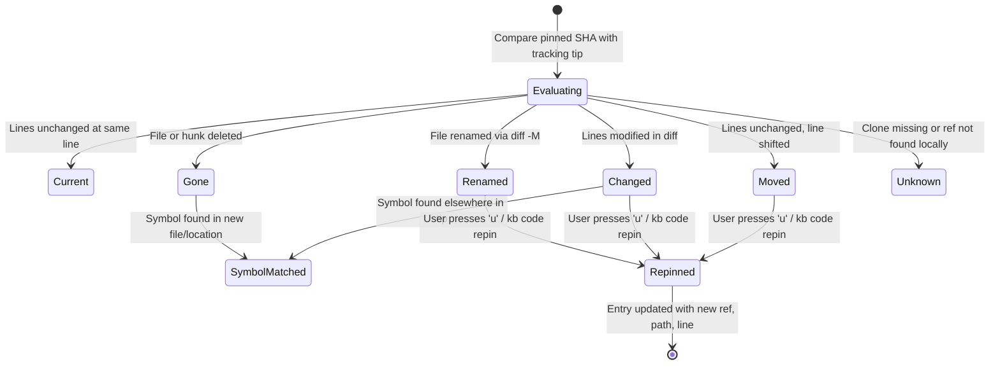

# Data Model: Actions and Code Links

**Branch**: `008-actions-code-links` | **Date**: 2026-10-09 | **Spec**: [spec.md](spec.md)

This document formalizes the data structures, lifecycles, and validation rules for actions, execution plans, console links, clone discovery, and code drift reports.

---

## 1. Action Model

The central abstraction representing any operation that can be executed against an entry.

### Entities

```rust
pub enum ActionKind {
    CopyPayload,
    CopyCodeLocation,
    CopyWebPermalink,
    OpenUrl,
    OpenEditor,
    RunCommand,
    CustomCommand,
    CodeView,
    RepinCode,
    FetchAndCheck,
}

pub struct Action {
    pub id: String,                 // stable identifier e.g. "open-sumo", "run", "psql"
    pub name: String,               // short user-visible name e.g. "Open in Sumo"
    pub key: char,                  // single-letter keyboard shortcut
    pub label: String,              // detailed description for menus
    pub kind: ActionKind,
    pub is_primary: bool,           // whether this is the entry type's default open action
    pub needs_vars: bool,           // requires M5 variable resolution prior to execution
    pub needs_confirm: bool,        // requires confirmation prompt before execution
    pub requires_local_clone: bool, // disabled if no local git clone is discovered
    pub requires_display: bool,     // disabled over SSH without GUI display
}
```

### Type Actions Registry

| Entry Type | Primary Action | Available Actions |
|---|---|---|
| `sql` | *(None / First Custom)* | `copy`, `custom...` |
| `sumo` | `open-sumo` (`Ctrl-O`) | `copy`, `open-sumo`, `custom...` |
| `cw` | `open-cw` (`Ctrl-O`) | `copy`, `open-cw`, `custom...` |
| `cmd` | *(None)* | `copy`, `run` (`Ctrl-G`), `custom...` |
| `prompt` | *(None)* | `copy`, `custom...` |
| `link` | `open-link` (`Ctrl-O`) | `copy-url`, `open-link`, `custom...` |
| `code` | `code-view` (`Ctrl-O`) | `copy-loc`, `copy-permalink`, `open-default`, `open-web`, `open-vscode`, `open-idea`, `check`, `repin`, `fetch`, `custom...` |

---

## 2. Command Execution: `RunPlan`

Formulated before running any `cmd` entry or custom action.

```rust
pub struct SecretEnvVar {
    pub env_key: String,       // e.g. "KB_SECRET_TOKEN"
    pub secret_value: String,  // scrubbed immediately after process spawn
}

pub struct RunPlan {
    pub resolved_command: String,       // command string with secrets replaced by $KB_SECRET_*
    pub shell: String,                  // e.g. "sh", "bash", "zsh", "fish"
    pub cwd: Option<PathBuf>,           // working directory (with ~ expanded)
    pub secret_env_vars: Vec<SecretEnvVar>,
    pub destructive_warnings: Vec<String>, // matches from destructive pattern scan
    pub requires_typed_run: bool,       // true if any destructive patterns matched
}

pub struct RunResult {
    pub exit_code: i32,                 // child exit code or 128 + signal
    pub duration: std::time::Duration,
    pub killed_by_signal: Option<i32>,
}
```

### Invariants & Validation
- Secret values MUST never be placed in `resolved_command` or logged.
- If `cwd` does not exist on disk, `RunPlan` construction fails with an error naming the missing directory.
- `requires_typed_run` is true whenever `destructive_warnings` is non-empty.

---

## 3. Console Links: `ConsoleLink`

Generated for `sumo` and `cw` entries.

```rust
pub enum ConsoleTarget {
    SumoLogic { base_url: String },
    CloudWatch { region: String, log_groups: Vec<String> },
}

pub struct ConsoleLink {
    pub target: ConsoleTarget,
    pub url: String,
    pub query_included: bool,          // false if URL exceeded 8,000 characters
    pub character_count: usize,
}
```

### Invariants
- URLs $\le$ 8,000 characters include the resolved query and range.
- URLs $>$ 8,000 characters set `query_included = false`, drop the query parameter from the URL, and copy the query to the clipboard.

---

## 4. Local Clone & Repository Mapping: `LocalClone`

Discovered repositories for `code` entries.

```rust
pub enum RemoteHost {
    GitHub,
    GitLab,
    Bitbucket,
    Custom(String),
}

pub struct LocalClone {
    pub repo_identifier: String,       // canonical "owner/name"
    pub local_path: PathBuf,           // absolute filesystem path
    pub remote_url: String,            // normalized remote URL
    pub host: RemoteHost,
    pub tracking_branch: String,       // resolved tracking branch (e.g. "origin/main")
    pub has_local_changes: bool,       // true if git working tree is dirty
}

pub struct CloneCache {
    pub entries: HashMap<String, CachedCloneEntry>,
}

pub struct CachedCloneEntry {
    pub path: PathBuf,
    pub remote_url: String,
    pub tracking_branch: String,
    pub checked_at: u64,               // epoch timestamp
}
```

### Cache Location & Lifecycle
- Persisted at `.kb/clones.json`.
- Invalidation: If `local_path` does not exist or `.git/HEAD` mtime changes, rediscovery is triggered.

---

## 5. Drift Detection & Re-pinning: `DriftReport`

Produced when inspecting a `code` entry against the tracking branch tip.

```rust
pub enum DriftStatus {
    Current,                           // lines unchanged at same line
    Moved { new_line: usize, new_end_line: Option<usize> },
    Changed { new_line: usize, diff_summary: String },
    Renamed { new_path: String, new_line: usize, new_end_line: Option<usize> },
    Gone { reason: String },
    Unknown { reason: String },
}

pub enum DriftConfidence {
    DiffMapped,                        // verified via git diff -M -U0 hunk mapping
    SymbolMatched,                     // fallback via symbol name search
}

pub struct DriftReport {
    pub entry_id: String,
    pub status: DriftStatus,
    pub pinned_ref: String,            // commit SHA
    pub pinned_path: String,
    pub pinned_line: usize,
    pub pinned_end_line: Option<usize>,
    pub tracking_branch: String,       // e.g. "origin/main"
    pub tracking_ref: Option<String>,  // tip commit SHA
    pub confidence: DriftConfidence,
}
```

### State Transitions



---

## 6. Custom Actions Configuration

```rust
pub enum CustomActionInput {
    Stdin,
    Arg,
}

pub struct CustomActionConfig {
    pub entry_type: String,            // "sql", "sumo", "cw", "cmd", "prompt", "link", "code"
    pub name: String,
    pub key: char,
    pub command: String,               // template with {{field}} placeholders
    pub input: CustomActionInput,      // defaults to Stdin
}
```
