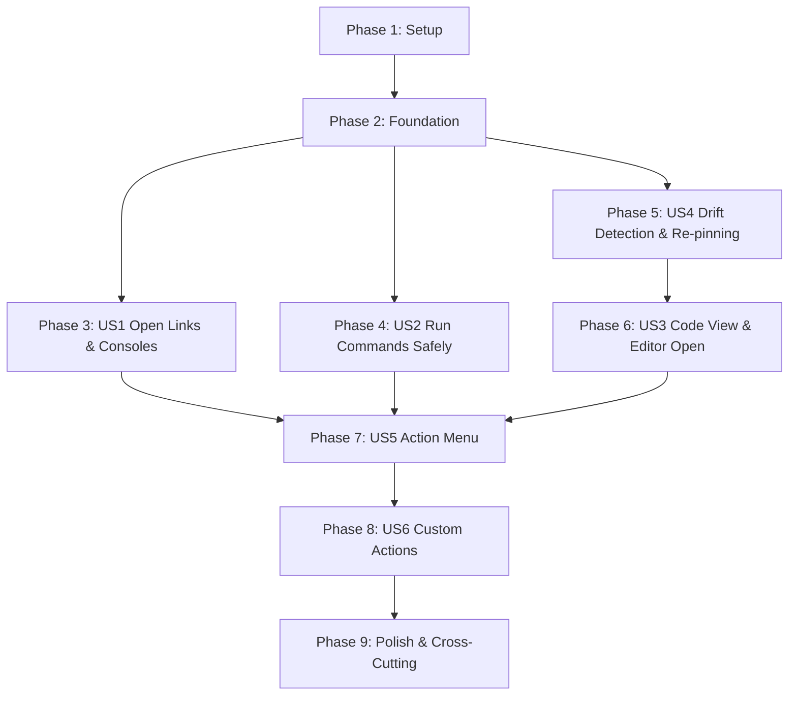

# Tasks: Actions and Code Links

**Input**: Design documents from `specs/008-actions-code-links/`
**Prerequisites**: [plan.md](plan.md), [spec.md](spec.md), [research.md](research.md), [data-model.md](data-model.md), [contracts/](contracts/), [quickstart.md](quickstart.md)

**Tests**: Required. Constitution VIII: `kb-core` domain logic (action registry, console URL builders, run plans, clone discovery, diff hunk line mapping, permalinks, re-pinning) follows red-green development: test tasks are written and verified failing before their implementation tasks. Glue (CLI commands, PTY terminal execution, TUI overlays) is tested alongside using `FakePlatform` and the PTY test harness.

**Organization**: Tasks are structured by phase and user story: Setup → Foundation → US1 (Open links & consoles) → US2 (Run commands safely) → US4 (Drift detection & re-pinning) → US3 (Code view & editor opening) → US5 (Action menu) → US6 (Custom actions) → Polish.

## Format: `- [ ] [TaskID] [P?] [Story?] Description with file path`

- **[P]**: Parallelizable (different files, no dependency on incomplete tasks)
- **[Story]**: `[US1]` to `[US6]` for user story phases; omitted for Setup, Foundation, and Polish phases

## Path Conventions

- Core: `crates/kb-core/src/` (`action.rs`, `run.rs`, `console.rs`, `code/`)
- Binary: `crates/kb/src/` (`platform/`, `commands.rs`, `tui/`)
- Integration tests: `tests/` (`cli_open.rs`, `cli_run.rs`, `cli_actions.rs`, `cli_code.rs`, `tui_code_pty.rs`, `tui_run_pty.rs`)
- Fixtures: `tests/fixtures/actions/` and `tests/fixtures/git_repos/`

---

## Phase 1: Setup

**Purpose**: Test fixtures, mock repositories, and module scaffolding.

- [X] T001 Create fixture git repositories in `tests/fixtures/git_repos/scripted_repo.sh`: script generating a local git repo with branches `main` and `origin/main`, 5 commits, with branches demonstrating (1) lines inserted above a function (`moved`), (2) function body edited (`changed`), (3) file renamed (`renamed`), (4) function deleted (`gone`), and (5) symbol present with edited signature for symbol fallback tests.
- [X] T002 [P] Create fixture entry files in `tests/fixtures/actions/entries/`: sample entries for `link`, `sumo` (with `range`), `cw` (with `region`, `log_groups`, `range`), `cmd` (with `shell`, `cwd`, `secret` var), and `code` (`repo`, `path`, `line`, `end_line`, `ref`, `branch`).
- [X] T003 [P] Create hostile command test matrix in `tests/fixtures/actions/hostile_commands.txt`: 30 dangerous commands testing `rm -rf`, `kubectl delete`, `terraform destroy`, `helm uninstall`, `aws .* delete-*`, `git push --force`, `git reset --hard`, `DROP TABLE`, `TRUNCATE`, `DELETE FROM` without `WHERE`, and device redirects (`> /dev/sda`).
- [X] T004 [P] Create empty module scaffolds: `crates/kb-core/src/action.rs`, `crates/kb-core/src/run.rs`, `crates/kb-core/src/console.rs`, `crates/kb-core/src/code/{mod,clone,drift,permalink,repin,snippet}.rs`, and declare modules in `crates/kb-core/src/lib.rs`.
- [X] T005 [P] Create empty TUI and command scaffolds: `crates/kb/src/tui/{action_view,code_view,run_modal}.rs` (declare in `crates/kb/src/tui/mod.rs`).

**Checkpoint**: `cargo build --workspace` passes; existing test suite remains green.

---

## Phase 2: Foundational (Blocking Prerequisites)

**Purpose**: Configuration schema, core Action model, and platform execution primitives required by all user stories.

### Tests first (must fail)

- [X] T006 [P] Write failing tests for configuration additions in `crates/kb-core/src/config.rs`: parse `[sumo].base_url`, `[aws].default_region`, `[code].default_open`, `[code].search_paths`, `[code].web_url`, `[code.repos]`, `[run].pause_after`, `[run].destructive_patterns`, and `[[actions.<type>]]` with `name`, `key`, `command`, `input`.
- [X] T007 [P] Write failing tests for Action model and ActionRegistry in `crates/kb-core/src/action.rs`: verify built-in action registry per type (FR-002), verify primary open actions for `sumo`, `cw`, `link`, `code`, and verify `Action` properties (`needs_vars`, `needs_confirm`, `requires_local_clone`, `requires_display`).
- [X] T008 [P] Write failing tests for `run_interactive_command` in `crates/kb/src/platform/unix.rs`: verify terminal raw mode release and restore, signal forwarding, execution duration timing, and exit status mapping (`128 + signal`).
- [X] T009 [P] Write failing tests for URL opener protocol dispatch in `crates/kb/src/platform/opener.rs`: verify handling of `vscode://file/...` and `idea://open?file=...` URL schemes.

### Implementation

- [X] T010 Implement configuration additions for `sumo`, `aws`, `code`, `run`, and `actions` in `crates/kb-core/src/config.rs`. Makes T006 pass.
- [X] T011 Implement `ActionKind`, `Action`, and `ActionService::list_actions` in `crates/kb-core/src/action.rs` (per data-model.md and `contracts/core-api.md`). Makes T007 pass.
- [X] T012 Implement `run_interactive_command` with alternate screen suspension, raw mode restoration, and exit code capture in `crates/kb/src/platform/unix.rs` and `crates/kb/src/platform/fake.rs`. Makes T008 pass.
- [X] T013 Update `Platform::open_url` to support desktop editor URL schemes (`vscode://`, `idea://`) in `crates/kb/src/platform/opener.rs`. Makes T009 pass.

**Checkpoint**: `cargo test --workspace` passes; all foundational unit tests pass.

---

## Phase 3: User Story 1 — Open links and console deep links (Priority: P1)

**Goal**: Open `link`, `sumo`, and `cw` entries in default browser or console with variables resolved and range prefilled via `kb open <id>` or `Ctrl-O`.

**Independent Test**: Run open action against fixture entries using `FakePlatform`; assert the exact URL passed to `open_url` matches expected URL. Verify SSH fallback copies and prints URL.

### Tests for User Story 1

- [X] T014 [P] [US1] Write failing tests for Sumo Logic deep link generator in `crates/kb-core/src/console.rs`: verify URL construction with `base_url`, query percent-encoding, relative range `-15m`/`-2h`/`-7d` translation to epoch milliseconds, and query omission when URL exceeds 8,000 characters (FR-007, FR-011).
- [X] T015 [P] [US1] Write failing tests for CloudWatch Logs Insights deep link generator in `crates/kb-core/src/console.rs`: verify URL construction with region, log groups, query, range, AWS console `$3F`/`$3D`/`~` encoding, query truncation at 8,000 characters, and region resolution precedence (`entry.region` -> `aws.default_region` -> `AWS_REGION` -> `AWS_DEFAULT_REGION`).
- [X] T016 [P] [US1] Write failing integration tests for `kb open` CLI in `tests/cli_open.rs`: test opening `link`, `sumo`, `cw` entries, variable resolution via `--var`, `--with console`, missing config error for Sumo without `base_url`, and SSH fallback printing/copying URL.

### Implementation for User Story 1

- [X] T017 [US1] Implement `ConsoleService::build_sumo_link` and range parser in `crates/kb-core/src/console.rs`. Makes T014 pass.
- [X] T018 [US1] Implement `ConsoleService::build_cw_link` and `ConsoleService::resolve_aws_region` in `crates/kb-core/src/console.rs`. Makes T015 pass.
- [X] T019 [US1] Implement `kb open` CLI subcommand handling argument resolution, variable prompting/flags, use recording, and opening via `Platform::open_url` in `crates/kb/src/commands.rs`. Makes T016 pass.
- [X] T020 [US1] Wire `Ctrl-O` keybinding in `crates/kb/src/tui/app.rs` and `crates/kb/src/tui/keys.rs` for `link`, `sumo`, and `cw` entries to execute their primary open action.

**Checkpoint**: `kb open link/foo`, `kb open sumo/5xx`, and `kb open cw/latency` open correctly; TUI `Ctrl-O` opens browser on selected link/console entries.

---

## Phase 4: User Story 2 — Run a command safely (Priority: P1)

**Goal**: Execute `cmd` entries safely with confirmation, destructive pattern detection, secret environment variable isolation, and full terminal restoration via `kb run <id>` or `Ctrl-G`.

**Independent Test**: Run fixture `cmd` entries through `FakePlatform` and PTY harness; verify confirmation prompt, child environment, secret isolation in `ps`, and reported exit code.

### Tests for User Story 2

- [X] T021 [P] [US2] Write failing tests for destructive pattern scanner in `crates/kb-core/src/run.rs`: verify all 30 hostile commands in `hostile_commands.txt` are detected as destructive, non-destructive commands pass, and user patterns from config are additive.
- [X] T022 [P] [US2] Write failing tests for `RunPlan` builder and secret isolation in `crates/kb-core/src/run.rs`: verify `secret` variables are substituted with `"$KB_SECRET_<NAME>"`, mapped to `secret_env_vars`, secrets never appear in `resolved_command`, non-existent `cwd` returns `MissingCwd` error, and shell defaults to entry's `shell` or `sh`.
- [X] T023 [P] [US2] Write failing integration tests for `kb run` CLI in `tests/cli_run.rs`: verify interactive confirmation (`y` to run), destructive confirmation (requires typing `run`), `--yes` without prompt, `--yes` on destructive command rejected without `--force`, exit code forwarding, and signal exit code (`128 + signal`).
- [X] T024 [P] [US2] Write failing PTY integration tests in `tests/tui_run_pty.rs`: verify `Ctrl-G` opens confirmation modal, running suspends TUI, terminal input/output works for interactive commands, post-run pause screen shows exit code and duration, and raw mode is restored cleanly.

### Implementation for User Story 2

- [X] T025 [US2] Implement `RunService::check_destructive` with built-in compiled regexes in `crates/kb-core/src/run.rs`. Makes T021 pass.
- [X] T026 [US2] Implement `RunService::build_run_plan` with secret env var extraction and shell quotation in `crates/kb-core/src/run.rs`. Makes T022 pass.
- [X] T027 [US2] Implement `kb run` CLI subcommand in `crates/kb/src/commands.rs` supporting `--yes`, `--force`, `--var`, and exit code forwarding. Makes T023 pass.
- [X] T028 [US2] Implement TUI Run Modal (`run_modal.rs`) and execution handler in `crates/kb/src/tui/app.rs`: render confirmation details, prompt for `run` on destructive commands, invoke `Platform::run_interactive_command`, display pause banner, and bind `Ctrl-G` in `crates/kb/src/tui/keys.rs`. Makes T024 pass.

**Checkpoint**: All 30 destructive commands require typed `run` confirmation; secrets never appear in process listings; terminal restores cleanly after runs.

---

## Phase 5: User Story 4 — Know when a code link has drifted, and re-pin it (Priority: P1)

**Goal**: Discover local clones, detect drift between pinned commit SHA and tracking branch tip using git diff, and re-pin moved/changed/renamed code links via `kb code check` and `kb code repin`.

**Independent Test**: Run drift check against scripted fixture git repository; verify exact detection of `current`, `moved`, `changed`, `renamed`, `gone`, and `unknown` statuses, and verify byte-for-byte format-preserving update on re-pinning.

### Tests for User Story 4

- [X] T029 [P] [US4] Write failing tests for local clone discovery and caching in `crates/kb-core/src/code/clone.rs`: verify lookup in `code.repos`, 1-level search in `code.search_paths`, SSH/HTTPS URL normalization (`git@github.com:...` == `https://github.com/...`), caching in `.kb/clones.json`, and cache invalidation on missing path.
- [X] T030 [P] [US4] Write failing tests for git diff line mapping in `crates/kb-core/src/code/drift.rs`: using `scripted_repo.sh`, test mapping pinned lines through `git diff -M -U0` hunks for `current`, `moved`, `changed`, `renamed`, and `gone`, tracking branch resolution priority (`code.branch` -> config -> `origin/HEAD` -> `origin/main` -> `origin/master`), and symbol search fallback.
- [X] T031 [P] [US4] Write failing tests for format-preserving re-pinning in `crates/kb-core/src/code/repin.rs`: verify byte-for-byte preservation of entry frontmatter comments and body, updating only `ref`, `path`, `line`, `end_line`, and `updated`, and rejecting write on concurrent file modifications.
- [X] T032 [P] [US4] Write failing integration tests for `kb code` CLI in `tests/cli_code.rs`: verify `kb code check [--json] [--fetch]`, exit 1 on drift, `kb code repin <id>... | --all [-y]`, and skipping `gone`/`unknown` entries.

### Implementation for User Story 4

- [X] T033 [US4] Implement `CodeService::find_clone`, remote URL normalizer, and `.kb/clones.json` caching in `crates/kb-core/src/code/clone.rs`. Makes T029 pass.
- [X] T034 [US4] Implement `CodeService::check_drift`, `git diff -M -U0` hunk parser, tracking branch resolver, and symbol fallback search in `crates/kb-core/src/code/drift.rs`. Makes T030 pass.
- [X] T035 [US4] Implement `CodeService::repin_entry` using format-preserving frontmatter updates and mtime check in `crates/kb-core/src/code/repin.rs`. Makes T031 pass.
- [X] T036 [US4] Implement `kb code check` and `kb code repin` CLI subcommands in `crates/kb/src/commands.rs`. Makes T032 pass.

**Checkpoint**: `kb code check` accurately detects drift on fixture repository; `kb code repin` updates only target fields byte-for-byte.

---

## Phase 6: User Story 3 — Open code where I work (Priority: P1)

**Goal**: View code snippet and drift status in TUI Code View (Screen 3) and open at target line in GitHub, VS Code, or IntelliJ.

**Independent Test**: Open fixture `code` entry in Code View; verify snippet rendering, drift badge, and URL/command generated for `g`, `v`, `i`, `y`, `Y`, `u`, `F`, and `Enter`.

### Tests for User Story 3

- [X] T037 [P] [US3] Write failing tests for git snippet extraction in `crates/kb-core/src/code/snippet.rs`: verify `git show <ref>:<path>` extracts lines with 3 lines context before and 8 lines after, and line range extraction when `end_line` is present.
- [X] T038 [P] [US3] Write failing tests for web permalink generation in `crates/kb-core/src/code/permalink.rs`: verify permalink formatting for GitHub, GitLab, Bitbucket, and custom `code.web_url` template, using full commit SHA and line/range anchors.
- [X] T039 [P] [US3] Write failing tests for `kb code show` CLI in `tests/cli_code.rs`: verify text snippet output and `--json` format.
- [X] T040 [P] [US3] Write failing PTY integration tests in `tests/tui_code_pty.rs`: verify `Ctrl-O` on code entry opens Code View (Screen 3), `Enter` triggers default open (`web`), `g` opens web permalink, `v` opens VS Code, `i` opens IntelliJ, `y` copies `path:line`, `Y` copies permalink, `u` re-pins, `F` fetches and re-checks, and `Esc` returns to list.

### Implementation for User Story 3

- [X] T041 [US3] Implement `CodeService::get_snippet` in `crates/kb-core/src/code/snippet.rs`. Makes T037 pass.
- [X] T042 [US3] Implement `CodeService::build_permalink` for GitHub, GitLab, Bitbucket, and custom hosts in `crates/kb-core/src/code/permalink.rs`. Makes T038 pass.
- [X] T043 [US3] Implement `kb code show` CLI subcommand in `crates/kb/src/commands.rs`. Makes T039 pass.
- [X] T044 [US3] Implement TUI Code View (Screen 3) in `crates/kb/src/tui/code_view.rs`: header metadata, syntax-highlighted code snippet box with target line marker (`▶`), drift status badge, disabled state when clone is missing, and key handling for `Enter`, `g`, `v`, `i`, `y`, `Y`, `u`, `F`, `Ctrl-E`, `Esc`. Wire into `crates/kb/src/tui/app.rs`. Makes T040 pass.

**Checkpoint**: Screen 3 renders code snippet with drift status; keys open in browser or desktop editors seamlessly.

---

## Phase 7: User Story 5 — One menu for every action (Priority: P2)

**Goal**: Provide a single menu (`Alt-A` / `F2`) listing all available actions for the selected entry with single-letter shortcuts, and CLI `kb actions <id>`.

**Independent Test**: Press `Alt-A` on fixture entries of each type; verify menu renders all available actions with primary action highlighted, pressing action key executes it, and `kb actions <id> --json` outputs matching list.

### Tests for User Story 5

- [X] T045 [P] [US5] Write failing integration tests for `kb actions` CLI in `tests/cli_actions.rs`: verify plain text list and `--json` schema output for each entry type.
- [X] T046 [P] [US5] Write failing PTY integration tests in `tests/tui_pty.rs`: verify `Alt-A` and `F2` open Action Menu popup overlay, pressing action key runs action, for `code` entries `Alt-A` opens Code View, and `Esc` closes menu.

### Implementation for User Story 5

- [X] T047 [US5] Implement `kb actions` CLI subcommand in `crates/kb/src/commands.rs`. Makes T045 pass.
- [X] T048 [US5] Implement TUI Action Menu modal (`action_view.rs`) in `crates/kb/src/tui/action_view.rs`: floating overlay window listing actions with keys, primary action first. Wire `Alt-A` and `F2` in `crates/kb/src/tui/keys.rs` and `crates/kb/src/tui/app.rs`. Makes T046 pass.
- [X] T049 [US5] Update TUI footer key bar in `crates/kb/src/tui/view.rs` to dynamically display the actions available for the currently selected entry type (FR-038).

**Checkpoint**: `Alt-A` displays all available actions across all entry types; `kb actions` prints action listings.

---

## Phase 8: User Story 6 — Pipe a query into my own tools (Priority: P3)

**Goal**: Support user-defined custom actions in `config.toml` (`[[actions.<type>]]`) with stdin/arg payload piping and `{{field}}` placeholder interpolation.

**Independent Test**: Define custom actions in test config; verify they appear in `kb actions`, execute via `kb run --action <name>`, and pipe resolved payload to child process.

### Tests for User Story 6

- [ ] T050 [P] [US6] Write failing tests for custom action parsing and placeholder validation in `crates/kb-core/src/action.rs`: verify `input` defaults to `stdin` if omitted, `input = "arg"` appends payload as last argument, `{{field}}` placeholders are shell-escaped, missing placeholder fields disable action, and key conflicts with built-in keys report warning and disable action.
- [ ] T051 [P] [US6] Write failing integration tests for custom actions in `tests/cli_run.rs`: verify `kb run <id> --action <name>` runs custom command, pipes payload via stdin, interpolates fields, and applies destructive checks.

### Implementation for User Story 6

- [ ] T052 [US6] Implement custom action resolution, field placeholder substitution, default `stdin` input handling, and key conflict detection in `crates/kb-core/src/action.rs` and `crates/kb-core/src/run.rs`. Makes T050 pass.
- [ ] T053 [US6] Wire `--action <name>` flag into `kb run` CLI subcommand in `crates/kb/src/commands.rs` and Action Menu in `crates/kb/src/tui/action_view.rs`. Makes T051 pass.

**Checkpoint**: Custom actions execute smoothly via CLI `--action` and TUI Action Menu.

---

## Phase 9: Polish & Cross-Cutting Concerns

**Purpose**: Enter key customization (`tui.enter = "primary"`), performance budget validation, documentation, and final end-to-end verification.

- [ ] T054 [P] Implement `tui.enter = "primary"` support in `crates/kb/src/tui/app.rs` and `crates/kb/src/tui/keys.rs`: when set to `primary`, Enter runs primary open action on `link`, `sumo`, `cw`, `code`; copies payload on `cmd`, `sql`, `prompt`. Enter MUST never run a command (FR-040). Add PTY tests in `tests/tui_pty.rs`.
- [ ] T055 [P] Implement performance benchmark tests in `tests/perf.rs`: assert drift check on single entry completes in $\le 500$ ms on 100,000-commit repository without fetching (FR-033), and `kb code check` across 200 entries in 10 repos finishes in $\le 10$ seconds (SC-006).
- [ ] T056 [P] Update user documentation in `README.md`: document new CLI subcommands (`kb open`, `kb run`, `kb actions`, `kb code check/repin/show`), new keybindings (`Ctrl-O`, `Ctrl-G`, `Alt-A`, `F2`), Code View controls, and `config.toml` options (`[sumo]`, `[aws]`, `[code]`, `[run]`, `[[actions.<type>]]`).
- [ ] T057 Execute full end-to-end verification scenarios from `specs/008-actions-code-links/quickstart.md` (including manual verification of SC-001 against real Sumo and AWS consoles), and verify `cargo test --workspace`, `cargo clippy --workspace --all-targets -- -D warnings`, and `cargo fmt --check` are 100% clean.

---

## Dependencies & Execution Order

### Phase Dependencies

### Parallel Opportunities

- Within **Phase 1**: Fixture creation (`T001`, `T002`, `T003`) and module scaffolding (`T004`, `T005`) are parallelizable.
- Within **Phase 2**: Failing unit tests (`T006`, `T007`, `T008`, `T009`) can be written concurrently across files.
- **US1** (`Phase 3`), **US2** (`Phase 4`), and **US4** (`Phase 5`) depend only on **Phase 2 (Foundation)** and can be implemented concurrently by independent developers.
- **US3** (`Phase 6`) depends on **US4** for clone and drift data structures.
- **US5** (`Phase 7`) unifies actions across US1, US2, and US3 into the Action Menu.
- **US6** (`Phase 8`) extends the action execution framework with user-defined actions.

---

## Implementation Strategy

### MVP Scope (User Story 1 Only)
1. Complete Phase 1 (Setup) and Phase 2 (Foundation).
2. Complete Phase 3 (US1 - Open Links & Console Deep Links).
3. Validate: `kb open` and TUI `Ctrl-O` immediately provide the most requested daily feature beyond copy.

### Incremental Delivery Order
1. **MVP**: Open links and console deep links (US1).
2. **Safe Runs**: Run commands with confirmation, destructive checks, and secret isolation (US2).
3. **Code Tracking Core**: Local clone discovery and drift detection/re-pinning (US4).
4. **Code View**: Full-screen preview, syntax highlighting, and editor opening (US3).
5. **Action Discovery**: Unified Action Menu overlay and dynamic key bar (US5).
6. **Extensibility**: Custom actions piping queries into external tools (US6).
7. **Production Polish**: Enter key mode, performance benchmarks, and documentation (Polish).
