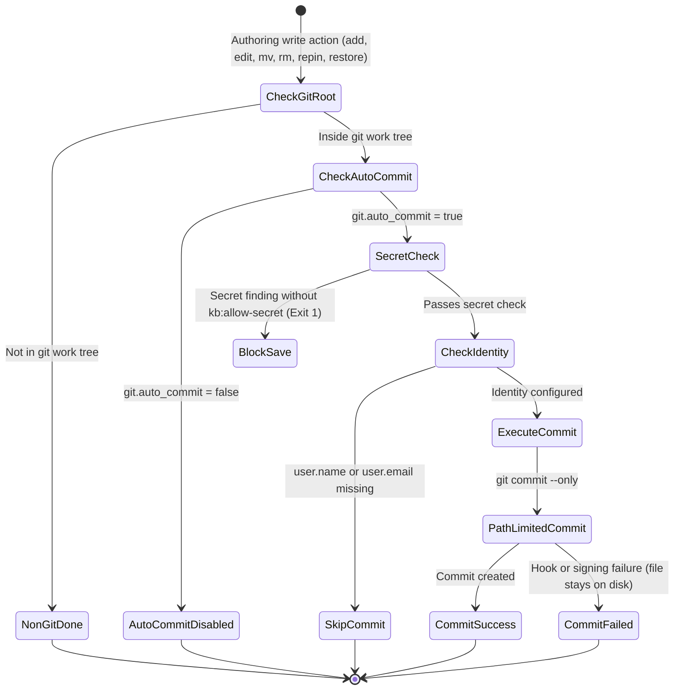
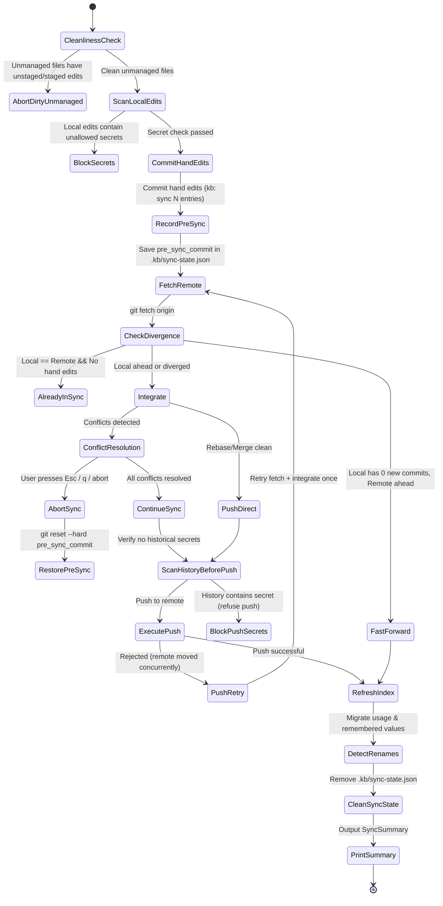

# Data Model: Git Sync

This document defines the core data entities, types, lifecycles, and state transitions for Milestone 9 (`009-git-sync`).

---

## 1. Core Entities & Structs

### 1.1 SyncStatus

Represents the sync state of the knowledge base without requiring network access (FR-025).

```rust
#[derive(Debug, Clone, PartialEq, Eq, Serialize, Deserialize)]
pub struct SyncStatus {
    /// True if the KB root is inside a git working tree
    pub is_git: bool,
    /// Currently checked-out branch (e.g., "main")
    pub branch: Option<String>,
    /// Upstream tracking branch (e.g., "origin/main")
    pub upstream: Option<String>,
    /// Number of local commits not yet pushed to upstream
    pub ahead: usize,
    /// Number of remote commits fetched but not yet integrated
    pub behind: usize,
    /// List of uncommitted entry files
    pub uncommitted: Vec<UncommittedEntry>,
    /// Non-entry files with unstaged or staged modifications
    pub unmanaged_changes: Vec<PathBuf>,
    /// Timestamp of last fetch (epoch seconds) from .git/FETCH_HEAD
    pub last_fetch: Option<u64>,
    /// In-progress sync or unresolved conflict state, if any
    pub in_progress: Option<SyncInProgressState>,
}

#[derive(Debug, Clone, PartialEq, Eq, Serialize, Deserialize)]
pub struct UncommittedEntry {
    pub id: String,
    pub rel_path: PathBuf,
    pub status: FileStatus,
}

#[derive(Debug, Clone, Copy, PartialEq, Eq, Serialize, Deserialize)]
pub enum FileStatus {
    Modified,
    Added,
    Deleted,
    Renamed,
}
```

---

### 1.2 SyncPlan & Execution Pipeline

Constructed prior to executing sync operations.

```rust
#[derive(Debug, Clone, PartialEq, Eq)]
pub struct SyncPlan {
    /// Commit SHA recorded immediately before integration for --abort rollback
    pub pre_sync_commit: String,
    /// Hand-edited entry files to commit in the pre-sync step
    pub hand_edits: Vec<PathBuf>,
    /// Local commits that will be pushed
    pub commits_to_push: Vec<CommitSummary>,
    /// Remote commits that will be integrated
    pub commits_to_integrate: Vec<CommitSummary>,
    /// Integration strategy (rebase or merge)
    pub strategy: SyncStrategy,
}

#[derive(Debug, Clone, Copy, PartialEq, Eq, Serialize, Deserialize, Default)]
pub enum SyncStrategy {
    #[default]
    Rebase,
    Merge,
}

#[derive(Debug, Clone, PartialEq, Eq, Serialize, Deserialize)]
pub struct CommitSummary {
    pub hash: String,
    pub short_hash: String,
    pub author: String,
    pub date: String,
    pub message: String,
}
```

---

### 1.3 Conflict & Resolution

Models entry-by-entry conflicts during rebase or merge integration.

```rust
#[derive(Debug, Clone, PartialEq, Eq)]
pub struct Conflict {
    /// Canonical entry ID (derived from path)
    pub id: String,
    /// File path relative to KB root
    pub rel_path: PathBuf,
    /// Nature of the conflict
    pub kind: ConflictKind,
    /// Content from local HEAD ("mine")
    pub mine: Option<String>,
    /// Content from incoming remote ("theirs")
    pub theirs: Option<String>,
    /// Common ancestor content ("base"), if available
    pub base: Option<String>,
}

#[derive(Debug, Clone, Copy, PartialEq, Eq, Serialize, Deserialize)]
pub enum ConflictKind {
    BothModified,
    ModifiedVsDeleted,
    DeletedVsModified,
    BothAdded,
    RenamedDifferently,
}

#[derive(Debug, Clone, PartialEq, Eq)]
pub enum ResolutionChoice {
    /// Keep local version ("mine")
    Mine,
    /// Keep remote version ("theirs")
    Theirs,
    /// Custom merged text edited by the user
    EditMerged(String),
    /// Keep local as `<id>`, save remote under new unique ID
    KeepBoth { new_id: String },
    /// In edit/delete conflict: confirm deletion
    Delete,
}

#[derive(Debug, Clone, PartialEq, Eq)]
pub struct Resolution {
    pub conflict: Conflict,
    pub choice: ResolutionChoice,
}
```

---

### 1.4 SyncInProgressState & Interrupted Sync Recovery

Persisted to `.kb/sync-state.json` while an integration is in progress to enable `--continue` and `--abort`.

```rust
#[derive(Debug, Clone, PartialEq, Eq, Serialize, Deserialize)]
pub struct SyncInProgressState {
    /// Commit SHA recorded prior to starting rebase/merge
    pub pre_sync_commit: String,
    /// Target remote and branch being integrated
    pub remote: String,
    pub branch: String,
    /// Strategy used
    pub strategy: SyncStrategy,
    /// List of paths remaining to be resolved
    pub remaining_conflicts: Vec<PathBuf>,
    /// Timestamp when sync started
    pub started_at: u64,
}
```

---

### 1.5 SyncSummary

Detailed audit report presented upon completion of `kb sync` (FR-009).

```rust
#[derive(Debug, Clone, PartialEq, Eq, Default, Serialize, Deserialize)]
pub struct SyncSummary {
    pub local_added: usize,
    pub local_modified: usize,
    pub local_deleted: usize,
    pub remote_added: usize,
    pub remote_modified: usize,
    pub remote_deleted: usize,
    pub conflicts_resolved: usize,
    pub warnings: Vec<String>,
    pub allowed_secrets: Vec<String>,
    pub unmanaged_files: Vec<PathBuf>,
    pub new_status: String,
}
```

---

### 1.6 EntryHistory & Diff

Represents historical versions for `kb history` and `kb restore`.

```rust
#[derive(Debug, Clone, PartialEq, Eq, Serialize, Deserialize)]
pub struct EntryHistory {
    pub id: String,
    pub commits: Vec<EntryCommit>,
}

#[derive(Debug, Clone, PartialEq, Eq, Serialize, Deserialize)]
pub struct EntryCommit {
    pub hash: String,
    pub short_hash: String,
    pub author: String,
    pub date: String,
    pub message: String,
    pub change_categories: Vec<ChangeCategory>,
}

#[derive(Debug, Clone, Copy, PartialEq, Eq, Serialize, Deserialize)]
pub enum ChangeCategory {
    Payload,
    Tags,
    Variables,
    Frontmatter,
    Renamed,
}

#[derive(Debug, Clone, PartialEq, Eq, Serialize, Deserialize)]
pub struct EntryDiff {
    pub id: String,
    pub rev: String,
    pub diff_text: String,
}
```

---

## 2. Lifecycles & State Transitions

### 2.1 Auto-Commit State Machine



---

### 2.2 `kb sync` Pipeline & Rollback


