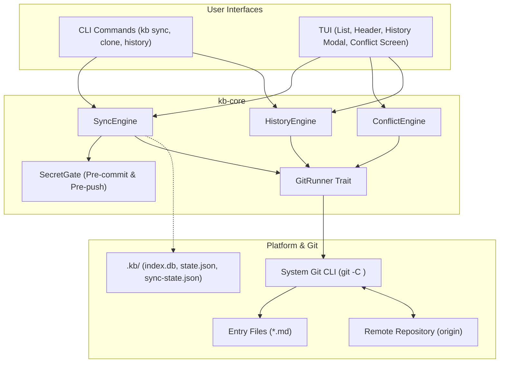

# Implementation Plan: Git Sync

**Branch**: `009-git-sync` | **Date**: 2026-10-10 | **Spec**: [spec.md](spec.md)

**Input**: Feature specification from `specs/009-git-sync/spec.md`

## Summary

Milestone 9 establishes Git-based synchronization as the standard mechanism for multi-machine synchronization, version history, and backup of the knowledge base without running any proprietary server. The implementation adheres to three foundational rules: **No data loss**, **No secrets leave the machine**, and **No surprise network access**.

Ten architectural decisions structure the implementation (detailed in [research.md](research.md)):

1. **Git CLI Delegation**: kb delegates all git actions directly to the installed system `git` CLI ($\ge 2.28$), using the user's identities, signing, credential helpers, and hooks without storing credentials or embedding libgit2 (R1).
2. **Atomic Path-Limited Auto-Commits**: Every write path (`add`, `edit`, `mv`, `rm`, `repin`, `restore`) creates a single commit limited strictly to touched paths (`git commit --only <paths>`), leaving unrelated staged or unstaged changes untouched (R2).
3. **Single-Command Sync Pipeline (`kb sync`)**: Orchestrates secret scanning, hand-edit batch committing, remote fetching, rebase integration, push, state migration, and index refreshing in an atomic pipeline (R3).
4. **Entry-by-Entry Conflict Resolution**: Integrates conflicting entries individually in TUI side-by-side view or CLI with choices: mine, theirs, edit merged, keep both (with collision prompting), and delete, with 100% clean rollback on abort (R4).
5. **Two-Stage Secret Gate**: Enforces pre-commit secret scanning on touched entries, deep history traversal before push (`@{u}..HEAD`), and provides pre-commit hook installation (`kb git install-hooks`) (R5).
6. **Cross-Machine Rename Migration**: Uses git rename detection across pre-sync and post-sync commits to migrate usage counts and remembered variable values, refreshing the disposable search index (R6).
7. **Setup & Clone Workflows**: Provides idempotent `kb sync setup <remote-url>` (with `.gitignore` generation and initial commit) and `kb clone <url> [path]` onboarding second devices (R7).
8. **Offline Status & Background Fetch**: `kb sync status` reports sync state without network access. `sync.fetch_on_start` provides non-blocking, credential-safe background fetching for the TUI (R8).
9. **Entry History & Revision Restore**: `kb history <id>` traces commits across renames; `kb restore <id> --at <rev>` writes historical content through lint, secret check, and auto-commit (R9).
10. **TUI Sync Badge & Conflict Screen**: Main list header indicators (`git ✓ in sync`, `↑2`, `↓3`, `● 4 changed`, `⚠ conflict`), `Alt-S` sync triggering, `Alt-H` history modal, and full-screen conflict screen (R10).

---

## Technical Context

**Language/Version**: Rust 2024, MSRV 1.88, `unsafe_code = forbid` (workspace standard).

**Primary Dependencies**: `ratatui`, `crossterm`, `clap`, `serde_json`, `regex`, `rusqlite`. **No new dependencies.** Git operations execute via the system `git` binary.

**Storage**:
- Entry files: UTF-8 Markdown files under KB root (`~/kb`).
- Git state: Standard `.git/` directory managed by git CLI.
- Derived & disposable state: `.kb/index.db` (SQLite FTS5), `.kb/state.json` (local usage & remembered values), `.kb/sync-state.json` (in-progress sync rollback checkpoint).
- Git ignore rules: `.kb/` git-ignored via `.kb/.gitignore` and root `.gitignore`.

**Testing**:
- `cargo test --workspace`.
- Unit tests in `kb-core` using `FakeGitRunner` for deterministic, zero-I/O git workflow verification.
- Integration tests in `tests/` using scripted temporary git repositories and bare remotes to verify multi-clone sync, auto-commit isolation, conflict resolution, and rollback.
- Secret gating test matrix checking all fixture secret patterns before commit and before push.

**Target Platform**: macOS (arm64, x86_64) and Linux (x86_64).

**Project Type**: Cargo workspace (`crates/kb-core` library and `crates/kb` binary).

**Performance Goals**:
- Auto-commit adds $\le 100$ ms to a save operation on a 10,000 entry repository (FR-005, SC-004).
- Offline status query $\le 50$ ms without network access (FR-025).
- TUI first paint $\le 100$ ms not delayed by background fetch (SC-005).
- Cloning and initial indexing $\le 1$ minute for 1,000 entries (SC-006).

**Constraints**:
- Strictly local-only: network access occurs only during explicit `kb sync`, `kb clone`, `kb sync setup`, explicit `--fetch`, and opt-in `sync.fetch_on_start` (Constitution III).
- Secrets never stored or pushed: any secret finding halts commit or push (Constitution VI, SC-003).
- Clean rollback: quitting during conflict resolution restores repository byte-for-byte to pre-sync state (SC-002).

---

## Constitution Check

*GATE: Must pass before Phase 0 research. Re-check after Phase 1 design.*

| Principle | Before Phase 0 | After Phase 1 | Notes |
|---|---|---|---|
| **I. Plain Files** | Pass | Pass | Git operates directly on plain Markdown entry files; no conversion or export step. |
| **II. Disposable Index** | Pass | Pass | `.kb/` is strictly git-ignored; after pull, index is refreshed from files. Usage statistics are local per machine. |
| **III. Local-Only** | Pass | Pass | Network access occurs only on user-initiated sync/clone/setup commands and opt-in background fetch; no daemon exists. |
| **IV. Terminal Only, One Core** | Pass | Pass | All sync logic, conflict planning, secret gating, and git abstractions live in `kb-core`. CLI and TUI share the identical engine. |
| **V. Portable** | Pass | Pass | Relies solely on standard Unix `git` CLI and portable process spawning. |
| **VI. Secrets Never Stored** | Pass | Pass | Gated before every commit and before every push across all unpushed commits in history. |
| **VII. Keyboard-First & Fast** | Pass | Pass | Single keybindings (`Alt-S`, `Alt-H`, conflict keys `m`/`t`/`e`/`b`/`d`); auto-commit budget $\le 100$ ms. |
| **VIII. Test-First Core** | Pass | Pass | Tested via red-green TDD with `FakeGitRunner` in core and multi-clone temporary git repos in integration tests. |
| **IX. Simplicity First** | Pass | Pass | No embedded libgit2; delegates to system `git` CLI and adds conflict flow on top. |

**Gate Result**: All principles pass with 0 violations.

---

## Project Structure

### Documentation (this feature)

```text
specs/009-git-sync/
├── spec.md              # Feature specification
├── plan.md              # This implementation plan
├── research.md          # Technical decisions R1–R10
├── data-model.md        # Entities, structs, and state machines
├── quickstart.md        # End-to-end verification guide
├── contracts/
│   ├── cli.md           # CLI commands, options, exit codes
│   ├── core-api.md      # kb-core Rust trait and engine interfaces
│   ├── config.md        # Configuration keys ([git], [sync])
│   └── tui-views.md     # Header badges, history modal, conflict screen
└── checklists/
    └── requirements.md  # Specification quality checklist
```

### Source Code Organization

```text
crates/kb-core/src/
├── git/                 # Git operations & execution
│   ├── mod.rs           # GitRunner trait, GitError, SystemGitRunner
│   ├── commit.rs        # Auto-commit logic (--only path limited)
│   ├── status.rs        # Local status & branch inspection
│   └── secrets.rs       # Pre-commit and pre-push secret scanning
├── sync/                # Synchronization engine
│   ├── mod.rs           # SyncEngine, SyncPlan, SyncSummary
│   ├── pipeline.rs      # Pipeline execution (commit, fetch, integrate, push)
│   ├── conflict.rs      # Conflict detection, presentation, resolution
│   └── state.rs         # SyncInProgressState (.kb/sync-state.json)
├── history.rs           # HistoryEngine (git log --follow, diff, show)
└── author/fsops.rs      # Integrated with auto_commit_operation

crates/kb/src/
├── commands/
│   ├── sync.rs          # `kb sync`, `kb sync status`, `kb sync setup`
│   ├── clone.rs         # `kb clone`
│   ├── hooks.rs         # `kb git install-hooks`, `kb git uninstall-hooks`
│   ├── history.rs       # `kb history`, `kb restore`
│   └── init.rs          # Extended `kb init --git`
├── platform/
│   └── unix.rs          # Interactive git execution & background batch runner
└── tui/
    ├── app.rs           # Alt-S, Alt-H dispatch, background fetch event handling
    ├── header.rs        # Header sync badge rendering
    ├── history.rs       # History overlay modal
    └── conflict.rs      # Full-screen side-by-side & stacked conflict screen
```

---

## Architecture



---

## Test Strategy

1. **Unit Tests (`kb-core`)**:
   - `test_auto_commit_path_limited`: Verifies `git commit --only` argument construction and template formatting.
   - `test_secret_gate_pre_commit`: Verifies fixture secrets block commit without `kb:allow-secret`.
   - `test_secret_gate_pre_push`: Verifies historical commits containing secrets are identified in `@{u}..HEAD`.
   - `test_conflict_parsing`: Verifies porcelain status parsing for all 5 conflict kinds.
   - `test_keep_both_collision_prompt`: Verifies prompt triggered when conflict filename already exists.
   - `test_rename_migration`: Verifies `git diff -M` output correctly migrates usage in `state.json`.

2. **Integration Tests (`tests/`)**:
   - `sync_two_clones_integration.rs`: Spin up a temporary bare git repository and two clones; perform alternating authoring operations and syncs; verify linear rebase history and identical entry contents (SC-001).
   - `sync_conflict_resolution.rs`: Scripted two-clone conflicts covering edit/edit, edit/del, and keep-both; verify resolved files pass lint and aborted conflicts restore pre-sync commit byte-for-byte (SC-002).
   - `auto_commit_isolation.rs`: Test that uncommitted manual edits to `README.md` or other staged files are never included in auto-commits (FR-005).
   - `unmanaged_files_guard.rs`: Test that unstaged edits to non-entry files halt `kb sync` before rebase with exit code 1.
   - `hook_installation.rs`: Verify pre-commit hook chaining and clean removal without modifying user hooks.

3. **Performance Benchmarks (`benches/` or integration tests)**:
   - Benchmark auto-commit overhead on a 10,000-entry fixture repository ($\le 100$ ms target, SC-004).
