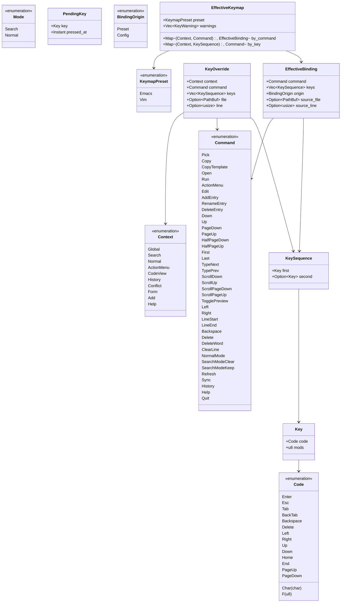

# Data Model: Vim Keymap and Configurable Key Bindings

**Feature Branch**: `013-vim-keymap` | **Date**: 2026-10-14  
**Spec**: [specs/013-vim-keymap/spec.md](spec.md)

---

## 1. Domain Entities & Value Objects

---

## 2. Entity Specifications

### 2.1 `KeymapPreset`
- **Definition**: Base preset configuration.
- **Values**:
  - `Emacs`: Default kb keymap. Search line always focused; actions require modifier chords (Ctrl / Alt).
  - `Vim`: Two-mode keymap (Search and Normal). Single-letter actions in Normal mode.
- **Source**: `tui.keymap` in config, `KB_TUI_KEYMAP` environment variable, or `--keymap` CLI flag.

### 2.2 `Context`
- **Definition**: Active TUI screen or interaction layer for key resolution.
- **Values**:
  - `Global`: Applies to both `Search` and `Normal` list modes. Does not cascade into sub-views.
  - `Search`: Main list search mode (query editing).
  - `Normal`: Main list normal mode (vim navigation & single-letter actions).
  - `ActionMenu`: Action menu modal.
  - `CodeView`: Code entry viewing screen.
  - `History`: Git history view.
  - `Conflict`: Git conflict resolution view.
  - `Form`: Variable prompt form (M5).
  - `Add`: Add entry form (M6).
  - `Help`: Help overlay.
- **Rules**:
  - Context names are lowercase kebab-case in TOML: `[tui.keys.<context>]`.
  - Contexts with text input (`Search`, `Form`, `Add`) forbid binding plain printable characters or multi-key sequences.

### 2.3 `Key` and `KeySequence`
- **Definition**: Concrete keystroke combination.
- **Modifiers bitmask**:
  - `SHIFT = 1`
  - `CTRL = 2`
  - `ALT = 4`
- **`KeySequence`**: Represents either a single key or a 2-key sequence (`"g g"`).
- **Invariants**:
  - Printable characters combined with `SHIFT` are stored as the uppercase character with `mods = 0` (e.g. `Shift-a` $\to$ `Char('A')`).
  - Printable characters combined with `CTRL` are stored as lowercase character with `mods = CTRL` (e.g. `Ctrl-A` $\to$ `Key { code: Char('a'), mods: CTRL }`).
  - Sequences are valid only in non-text contexts (`Normal`, `ActionMenu`, `CodeView`, `Help`).

### 2.4 `PendingKey`
- **Definition**: Ephemeral state in the TUI when the first key of a sequence is pressed.
- **Fields**:
  - `key: Key`: The initial key pressed (e.g. `g`).
  - `pressed_at: Instant`: Timestamp when received.
- **Transitions**:
  - On timeout (> 1.0 s): cleared automatically.
  - On matching sequence completion (`g`): executes `First`, cleared.
  - On Esc: cleared immediately without action.
  - On any other key: cleared immediately; follow-up key executed as standalone normal-mode command.

### 2.5 `Command`
- **Definition**: Stable domain action dispatched by the keymap.
- **Kebab-case string representation**: Documented in `contracts/key-commands.md`.
- **Invariants**:
  - Every command has a unique stable string identifier.
  - Old command names maintain deprecated aliases if renamed in future specs.

### 2.6 `EffectiveKeymap`
- **Definition**: The complete resolved mapping computed at startup.
- **Fields**:
  - `preset`: Active `KeymapPreset`.
  - `bindings`: Map from `(Context, Command)` to `EffectiveBinding`.
  - `dispatch`: Map from `(Context, KeySequence)` to `Command`.
  - `warnings`: Accumulated non-fatal validation warnings.
- **Resolution Algorithm**:
  1. Populate baseline entries from `preset`.
  2. For each configured override in `[tui.keys.global]`:
     - If valid: replaces the command's bindings for both `Search` and `Normal` list modes (unless shadowed by specific mode override).
  3. For each configured override in `[tui.keys.<context>]`:
     - If valid: replaces the command's bindings for that specific context. If an override reuses a key already bound by the preset to another command, the override wins and the preset command loses that key (with a notice).
     - If invalid: record a warning (with file, line, and reason) and discard the override.
  4. Validate reserved keys: Ensure `Ctrl-C` is intact, run/delete confirmations are intact, and list modes retain at least one key for `Help` and `Quit`. If violated, revert offending override with a warning.
