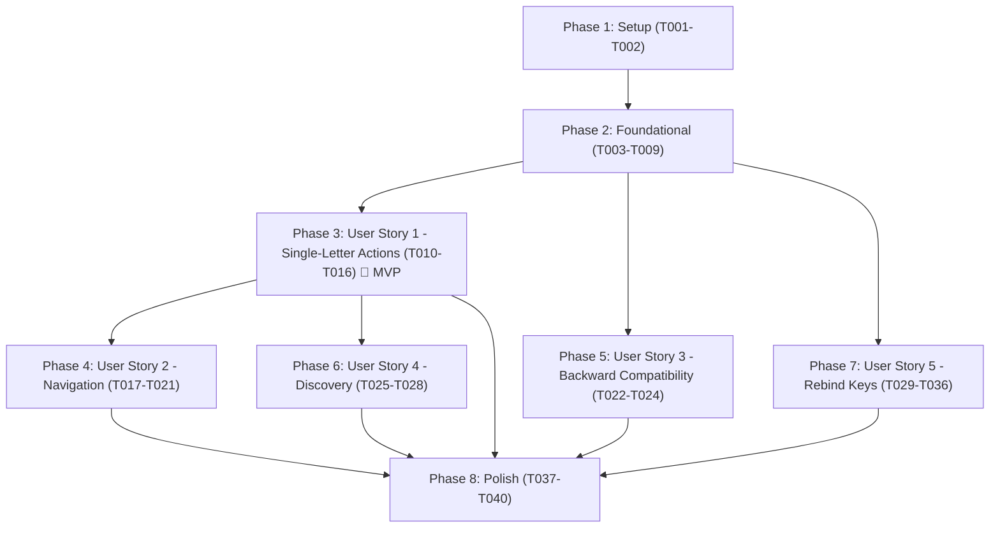

# Implementation Tasks: Vim Keymap and Configurable Key Bindings

**Branch**: `013-vim-keymap` | **Date**: 2026-10-14  
**Spec**: [specs/013-vim-keymap/spec.md](spec.md) | **Plan**: [specs/013-vim-keymap/plan.md](plan.md)

---

## Phase 1: Setup (Shared Infrastructure)

**Purpose**: Initialize core key module structure and configuration settings.

- [X] T001 Create key module directory structure in `crates/kb-core/src/keys/` and register module in `crates/kb-core/src/lib.rs`
- [X] T002 Add `tui.keymap` choice setting (`"emacs"`, `"vim"`, default `"emacs"`, env `KB_TUI_KEYMAP`) to `SETTINGS` in `crates/kb-core/src/config.rs`

---

## Phase 2: Foundational (Blocking Prerequisites)

**Purpose**: Core key data types, parser, presets, and effective keymap resolution in `kb-core`.

**⚠️ CRITICAL**: Must be completed before any user story can be implemented.

- [X] T003 [P] Implement `Code`, `Key`, and modifier bitmasks (`SHIFT = 1`, `CTRL = 2`, `ALT = 4`) in `crates/kb-core/src/keys/code.rs`
- [X] T004 [P] Implement `Context` enum (`Global`, `Search`, `Normal`, `ActionMenu`, `CodeView`, `History`, `Conflict`, `Form`, `Add`, `Help`) in `crates/kb-core/src/keys/context.rs`
- [X] T005 [P] Implement `Command` enum and kebab-case string mapping for all ~40 actions in `crates/kb-core/src/keys/command.rs`
- [X] T006 Implement key syntax parser supporting modifiers (`ctrl-`, `alt-`, `shift-`), named keys (`enter`, `esc`, `tab`, `up`, `down`, etc.), single characters, and 2-key sequences (`"g g"`) in `crates/kb-core/src/keys/parse.rs`
- [X] T007 Implement static presets for `emacs` and `vim` with compile-time duplicate validation in `crates/kb-core/src/keys/preset.rs`
- [X] T008 Implement `EffectiveKeymap` builder, context override application, and warning diagnostics in `crates/kb-core/src/keys/effective.rs`
- [X] T009 Add unit tests for key parsing, preset validation, and effective keymap resolution in `crates/kb-core/src/keys/tests.rs`

**Checkpoint**: Core key domain model and resolution engine ready and verified with unit tests.

---

## Phase 3: User Story 1 - Search, then act with single letters (Priority: P1) 🎯 MVP

**Goal**: Dual-mode main list (`search` and `normal`) for the `vim` keymap, allowing single-letter actions (`o`, `e`, `y`, `!`, `m`, `.` etc.) after Esc, switching back with `/` or `i`/`a`, Esc query clear and exit 130.

**Independent Test**: PTY tests with `tui.keymap = "vim"` against fixture KB: type `5xx auth`, press Esc (verify `NORMAL` badge), press `o` (verify open action), press `j` and `y` (verify copy action), press `/` (verify `SEARCH` badge and cleared query).

- [X] T010 [P] [US1] Unit test mode state transitions (`Search` <-> `Normal`, Esc, `/`, `i`, `a`) in `crates/kb/tests/tui_vim_keymap.rs`
- [X] T011 [US1] Add `Mode` tracking (`Search` vs `Normal`) and query cursor visibility flag to `crates/kb/src/tui/state.rs`
- [X] T012 [US1] Adapt `crossterm::event::KeyEvent` into `kb_core::keys::Key` and wire action dispatch through `EffectiveKeymap` in `crates/kb/src/tui/keys.rs`
- [X] T013 [US1] Implement normal-mode single-letter action dispatch (`o` open, `e` edit, `y` copy, `!` run confirmation, `m`/`.` action menu, `n` add, `R` rename, `D` delete, `s` sync, `H` history) in `crates/kb/src/tui/mod.rs`
- [X] T014 [US1] Render header mode badge (`NORMAL` / `SEARCH` in bold text, max 8 columns, `NO_COLOR` compatible) in `crates/kb/src/tui/view.rs`
- [X] T015 [US1] Implement normal-mode Esc handling (clear non-empty query; exit with code 130 if query is empty) and `q` exit in `crates/kb/src/tui/mod.rs`
- [X] T016 [US1] PTY integration test for search, mode switch to normal, single-letter actions, and returning to search in `crates/kb/tests/tui_vim_keymap.rs`

**Checkpoint**: User Story 1 complete. TUI can search, switch to normal mode, and trigger actions with single keys.

---

## Phase 4: User Story 2 - Navigate with arrows or vim keys (Priority: P1)

**Goal**: Seamless navigation in both modes with arrow keys; normal mode navigation with `h j k l`, `gg` / `G`, Home / End, PgUp / PgDn, `Ctrl-D` / `Ctrl-U`, `J` / `K` preview scrolling, and sequence interruption.

**Independent Test**: Automated PTY navigation test sending combinations of `j`/`k`, `h`/`l`, `gg`/`G`, arrow keys, and verifying selection index, active type filter, and preview scroll offset.

- [X] T017 [P] [US2] Unit test for `gg` multi-key sequence, 1s timeout, Esc cancellation, and sequence interruption in `crates/kb/tests/tui_vim_keymap.rs`
- [X] T018 [US2] Add `PendingKey` state and 1-second timeout tracking to `crates/kb/src/tui/state.rs`
- [X] T019 [US2] Implement vim navigation handlers (`j`/`k` move selection, `h`/`l` switch type filter, `Ctrl-D`/`Ctrl-U` half-page, `J`/`K` preview scroll) in `crates/kb/src/tui/mod.rs`
- [X] T020 [US2] Implement `gg` sequence handling and immediate sequence interruption (execute incoming key if not `g`) in `crates/kb/src/tui/mod.rs`
- [X] T021 [US2] PTY integration test verifying arrow keys and vim navigation keys across both modes in `crates/kb/tests/tui_vim_keymap.rs`

**Checkpoint**: User Stories 1 and 2 work together. Complete arrow and vim key navigation operational.

---

## Phase 5: User Story 3 - Nothing changes unless I opt in (Priority: P1)

**Goal**: Guarantee zero regressions for default `emacs` keymap users, verify all Ctrl/Alt bindings work in both modes of `vim`, and enforce `--keymap` flag and `KB_TUI_KEYMAP` precedence.

**Independent Test**: Execute the full existing TUI test suite without configuration changes; assert zero test failures, identical behavior key for key, and no mode indicator shown.

- [X] T022 [P] [US3] Add CLI flag `--keymap <emacs|vim>` to `crates/kb/src/main.rs` and wire precedence (`--keymap` > `KB_TUI_KEYMAP` > `tui.keymap` > `emacs`) in `crates/kb/src/config.rs`
- [X] T023 [US3] Verify and assert existing Ctrl and Alt bindings (Ctrl-O, Ctrl-G, Alt-A, Alt-S, etc.) remain active in both `Search` and `Normal` modes of `vim` in `crates/kb-core/src/keys/preset.rs`
- [X] T024 [US3] Run full existing TUI test suite in `crates/kb/tests/` with default `emacs` keymap verifying zero regressions and no mode badge

**Checkpoint**: Default keymap verified with 100% backwards compatibility and CLI precedence established.

---

## Phase 6: User Story 4 - Discover the keys (Priority: P2)

**Goal**: Dynamic key bar and help overlay generated from the effective keymap for the active mode, including `g…` sequence indicator.

**Independent Test**: Open help overlay with `?` in both modes to verify mode-specific groupings; verify key bar displays letters in normal mode and `g…` when `g` is pressed.

- [X] T025 [P] [US4] Update help overlay generation in `crates/kb/src/tui/view.rs` to group bindings by mode (`Normal`, `Search`, etc.) for the active keymap
- [X] T026 [US4] Update bottom key bar generation in `crates/kb/src/tui/view.rs` to display mode-specific key hints (letters in normal mode, chords in search mode)
- [X] T027 [US4] Render `g…` indicator in key bar during active `PendingKey` state in `crates/kb/src/tui/view.rs`
- [X] T028 [US4] Snapshot and visual verification test for normal mode help overlay and key bar in `crates/kb/tests/tui_vim_keymap.rs`

**Checkpoint**: In-context key discovery and sequence indicators operational.

---

## Phase 7: User Story 5 - Rebind any key to my liking (Priority: P1)

**Goal**: User configuration overrides via `[tui.keys.<context>]`, override conflict resolution, reserved keys protection, `kb keys`, `kb keys check`, `kb keys defaults`, and `kb doctor` integration.

**Independent Test**: Load fixture config files with overrides, conflicts, reserved keys, and invalid syntax; verify effective bindings, warnings, `kb keys check` exit codes, and that rebound keys execute their commands.

- [X] T029 [P] [US5] Add TOML parser for `[tui.keys.<context>]` tables in `crates/kb-core/src/config.rs` collecting `KeyOverride` entries and source line spans
- [X] T030 [US5] Implement conflict resolution rules (override replaces preset, duplicate overrides ignored with warning, non-text contexts for sequences) in `crates/kb-core/src/keys/effective.rs`
- [X] T031 [US5] Implement reserved keys protection (rebind/unbind of `Ctrl-C` rejected, confirmation answers fixed, list modes require `help` and `quit`) in `crates/kb-core/src/keys/effective.rs`
- [X] T032 [US5] Implement `kb keys [--context <name>] [--keymap <name>] [--json]` in `crates/kb/src/commands/keys.rs`
- [X] T033 [US5] Implement `kb keys check [--json]` (exiting 1 on any configuration issue or warning, 0 if clean) in `crates/kb/src/commands/keys.rs`
- [X] T034 [US5] Implement `kb keys defaults [--keymap <name>]` generating commented TOML block in `crates/kb/src/commands/keys.rs`
- [X] T035 [US5] Integrate `kb keys check` into `kb doctor` in `crates/kb/src/doctor.rs`
- [X] T036 [US5] Integration tests in `crates/kb/tests/cli_keys.rs` verifying valid overrides, invalid overrides (warnings), `kb keys check` exit codes, and reserved key protections

**Checkpoint**: Full key configurability, diagnostics, and safety enforcement operational.

---

## Phase 8: Polish & Cross-Cutting Concerns

**Purpose**: Documentation, spec amendments, quickstart validation, and codebase health.

- [X] T037 [P] Update `README.md` key reference documenting the vim keymap and configuration options, updating documentation parity tests in `crates/kb/tests/readme.rs`
- [X] T038 [P] Amend key tables in existing spec files (003 FR-010, 007 FR-027, 008 FR-037, 009 FR-029) per FR-017
- [X] T039 Run full quickstart validation scenarios from `specs/013-vim-keymap/quickstart.md`
- [X] T040 Run workspace verification: `cargo clippy --all-targets --all-features -- -D warnings` and `cargo test --workspace`

---

## Dependencies & Execution Order

### Phase Dependencies
- **Setup (Phase 1)**: Independent, starts immediately.
- **Foundational (Phase 2)**: Depends on Setup; BLOCKS all user stories.
- **User Story 1 (Phase 3, P1)**: Core dual-mode list functionality; MVP slice.
- **User Story 2 (Phase 4, P1)**: Extends US1 with full vim navigation and `gg` sequences.
- **User Story 3 (Phase 5, P1)**: Validates emacs stability and flag precedence.
- **User Story 4 (Phase 6, P2)**: Extends US1 and US2 display (key bar and help).
- **User Story 5 (Phase 7, P1)**: Implements TOML overrides, CLI inspection, and doctor check.
- **Polish (Phase 8)**: Depends on all user stories completing.

### Parallel Opportunities

- **Phase 2**: T003 (`code.rs`), T004 (`context.rs`), T005 (`command.rs`) can be written concurrently.
- **Phase 3**: T010 (test harness) can be written in parallel with T014 (badge rendering).
- **Phase 4**: T017 (sequence tests) can run in parallel with T018 (state struct).
- **Phase 7**: T029 (TOML parser) and T034 (defaults generator) can proceed in parallel.
- **Phase 8**: T037 (`README.md`) and T038 (spec amendments) can be edited in parallel.

---

## Implementation Strategy

### MVP Milestone (Phases 1, 2, and 3)
1. Complete Setup and Foundational crates domain types.
2. Implement User Story 1 (dual-mode main list, single-letter actions, Esc switching).
3. Validate independent MVP test criteria. Carlos can type to search, press Esc, and act on entries without modifier keys.

### Incremental Feature Delivery
1. Foundation + US1 $\to$ Functional MVP with single-key actions.
2. US2 $\to$ Full vim navigation (`h j k l`, `gg`, `Ctrl-D`/`Ctrl-U`).
3. US3 $\to$ Strict verification of default keymap zero-regression guarantee.
4. US4 $\to$ Dynamic key bar and grouped help overlay.
5. US5 $\to$ Full user customizability, `kb keys check`, and `kb doctor` integration.
6. Polish $\to$ Documentation updates and comprehensive test suite verification.
